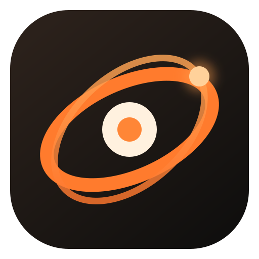
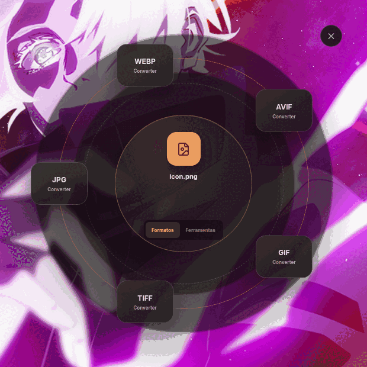
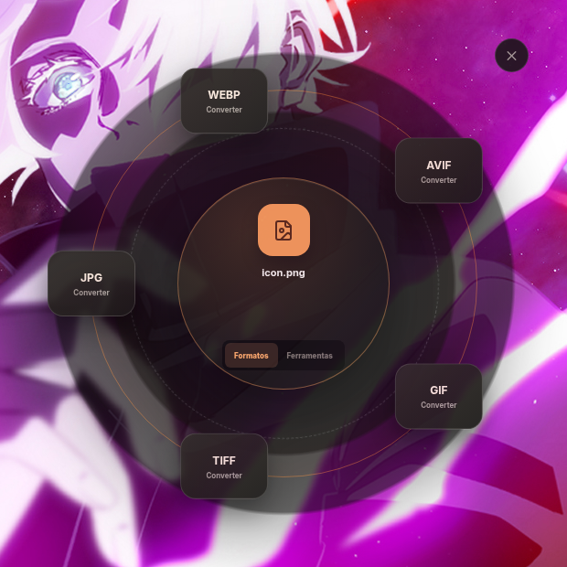
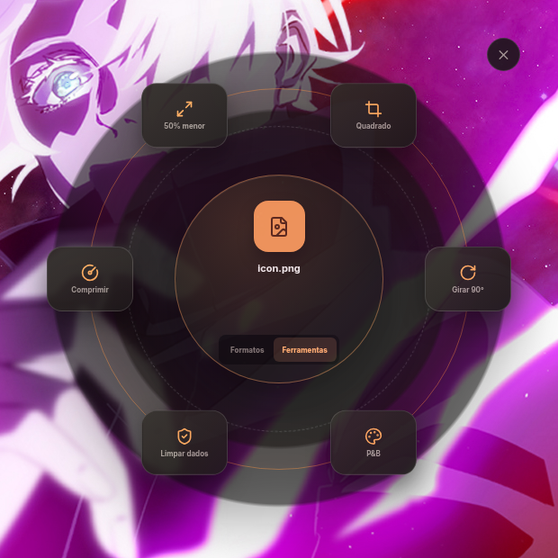

<p align="center">
  
</p>

<h1 align="center">Orbita</h1>

<p align="center">
  Converta e edite arquivos em um menu circular sobre a área de trabalho.<br>
  Sem upload, sem conta e sem interromper o seu fluxo.
</p>

<p align="center">
  <a href="https://github.com/Pedroxbr16/orbita-desktop/actions/workflows/build-desktop.yml"></a>
  
  
  
</p>

<p align="center">
  
</p>

<p align="center">
  <a href="docs/assets/orbita-demo.mp4">▶ Assistir à demonstração em MP4</a>
</p>

## O que é

O Orbita é um comando desktop multiplataforma que recebe um ou mais arquivos e exibe somente as ações relevantes ao redor deles. A conversão acontece no próprio computador com FFmpeg; documentos usam uma instalação local do LibreOffice.

O fluxo padrão não abre um aplicativo convencional:

1. Acione o Orbita passando um arquivo ou pelo atalho do sistema.
2. Escolha um formato ou uma ferramenta no menu circular.
3. Encontre o resultado na pasta `Orbita`, ao lado do arquivo original.

```text
/home/usuario/Imagens/foto.png
└── Orbita/
    └── foto-convertido.webp
```

## Interface

<table>
  <tr>
    <td align="center"></td>
    <td align="center"></td>
  </tr>
  <tr>
    <td align="center"><strong>Conversão de formatos</strong></td>
    <td align="center"><strong>Ferramentas rápidas</strong></td>
  </tr>
</table>

## Como usar

### Atalho global

Na integração Fedora/Hyprland usada no desenvolvimento, pressione:

```text
Super + Shift + O
```

Escolha os arquivos e a órbita aparecerá sobre a área de trabalho.

### Terminal

Passe um ou vários arquivos diretamente. Assim não aparece nem mesmo o seletor de arquivos:

```bash
orbita ~/Imagens/foto.png
orbita ~/Vídeos/video.mp4 ~/Vídeos/outro.mov
```

Caminhos com espaços também funcionam:

```bash
orbita "$HOME/Vídeos/Meu vídeo.mov"
```

### Nautilus

Na instalação Fedora preparada para o projeto:

1. Selecione um ou mais arquivos.
2. Clique com o botão direito.
3. Acesse **Scripts → Orbita**.
4. Escolha a ação na órbita.

### Modo avançado

A interface completa continua disponível para escolher pasta de saída e ajustar opções detalhadas:

```bash
orbita --workspace
```

## Formatos e ferramentas

| Categoria | Entradas principais | Saídas e ações |
|---|---|---|
| Imagens | JPG, JPEG, PNG, WebP, AVIF, HEIC, HEIF, GIF, TIFF | JPG, PNG, WebP, AVIF, GIF, TIFF, compressão, redimensionamento, recorte, rotação, P&B e limpeza de metadados |
| Vídeos | MP4, MOV, MKV, WebM, AVI, M4V, MPEG, WMV, FLV e 3GP | MP4, WebM, MOV, MKV, GIF, compressão, corte, limpeza de metadados e extração de MP3 |
| Áudios | MP3, WAV, M4A, AAC, OGG, FLAC, Opus e WMA | MP3, WAV, M4A, OGG, FLAC, compressão, corte e limpeza de metadados |
| Documentos | DOC, DOCX, ODT, RTF, TXT, XLS, XLSX, ODS, CSV, PPT, PPTX e ODP | PDF e formatos compatíveis com o LibreOffice instalado |

> A disponibilidade de codecs menos comuns, especialmente HEIC/HEIF, pode variar conforme a plataforma. Conversões de documentos exigem LibreOffice.

## Privacidade

- Os arquivos não saem do computador.
- Não existe servidor de conversão, telemetria ou conta obrigatória.
- FFmpeg e FFprobe são distribuídos com o aplicativo.
- O Orbita só grava o resultado na pasta de saída escolhida.
- A opção **Limpar dados** remove metadados do arquivo gerado.

## Baixar os instaladores

O GitHub Actions gera os pacotes de cada plataforma:

1. Abra [Actions → Build desktop installers](https://github.com/Pedroxbr16/orbita-desktop/actions/workflows/build-desktop.yml).
2. Entre na execução mais recente concluída com sucesso.
3. Baixe o artefato correspondente:
   - `orbita-windows`: instalador e versão portátil `.exe`;
   - `orbita-macos`: `.dmg` e `.zip`;
   - `orbita-linux`: AppImage.

Os artefatos permanecem disponíveis por 14 dias. Tags no formato `v*`, como `v0.1.0`, também publicam os três pacotes em **Releases**.

### Linux AppImage

```bash
chmod +x Orbita-0.1.0.AppImage
./Orbita-0.1.0.AppImage ~/Imagens/foto.png
```

Se a distribuição não possuir `libfuse.so.2`, extraia o AppImage:

```bash
./Orbita-0.1.0.AppImage --appimage-extract
APPDIR="$PWD/squashfs-root" ./squashfs-root/AppRun ~/Imagens/foto.png
```

### Windows e macOS

Os pacotes ainda não possuem assinatura de código. O Windows SmartScreen e o macOS Gatekeeper podem exibir um aviso na primeira execução. Para distribuição pública, configure os certificados de assinatura como secrets do repositório.

## Desenvolvimento

Requer Node.js 22.

```bash
git clone https://github.com/Pedroxbr16/orbita-desktop.git
cd orbita-desktop
npm install
npm run dev
```

Comandos disponíveis:

| Comando | Finalidade |
|---|---|
| `npm run dev` | Vite e Electron em modo de desenvolvimento |
| `npm start` | Interface completa de desenvolvimento |
| `npm test` | Testes do motor de conversão |
| `npm run check` | Sintaxe e bundle do renderer |
| `npm run dist:linux` | AppImage Linux |
| `npm run dist:win` | Instalador e executável portátil Windows |
| `npm run dist:mac` | DMG e ZIP macOS |

## Arquitetura

```text
Atalho, terminal ou gerenciador de arquivos
                    │
                    ▼
        Electron — processo principal
            │                 │
            ▼                 ▼
     Overlay React       Motor de arquivos
      menu circular      FFmpeg / FFprobe
                              │
                              └── LibreOffice para documentos
```

- `electron/main.cjs`: janelas, integração com o sistema e IPC.
- `electron/converter.cjs`: inspeção, conversão e edição local.
- `src/Overlay.jsx`: experiência circular acionada por comando.
- `src/App.jsx`: modo avançado opcional.
- `.github/workflows/build-desktop.yml`: matriz de builds para Linux, Windows e macOS.

## CI e releases

O workflow roda testes e empacotamento em todo push para `main`, pull request ou execução manual. Para criar uma release:

```bash
git tag v0.1.0
git push origin v0.1.0
```

O GitHub gera as notas da versão e anexa automaticamente todos os instaladores.

## Limitação do gesto global no Wayland

O Wayland não permite que aplicativos comuns interceptem globalmente `Shift + arrastar` originado em outros programas. No Linux, o Orbita oferece o mesmo resultado por comando, atalho global e menu do Nautilus. Windows e macOS podem receber integrações nativas futuras por shell extension e Finder Sync Extension.

## Licença

Distribuído sob a licença [MIT](LICENSE). O FFmpeg, Electron e demais dependências preservam suas respectivas licenças.
